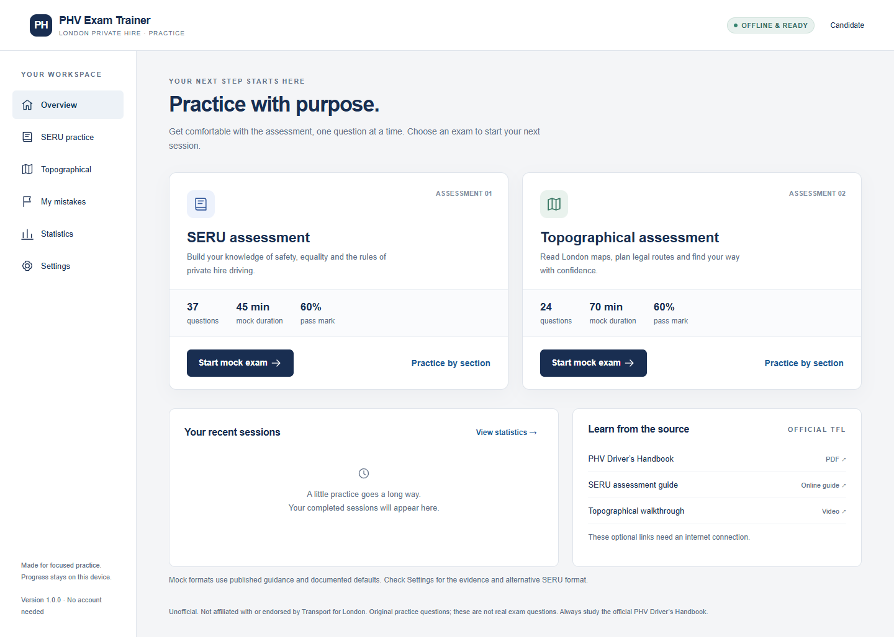
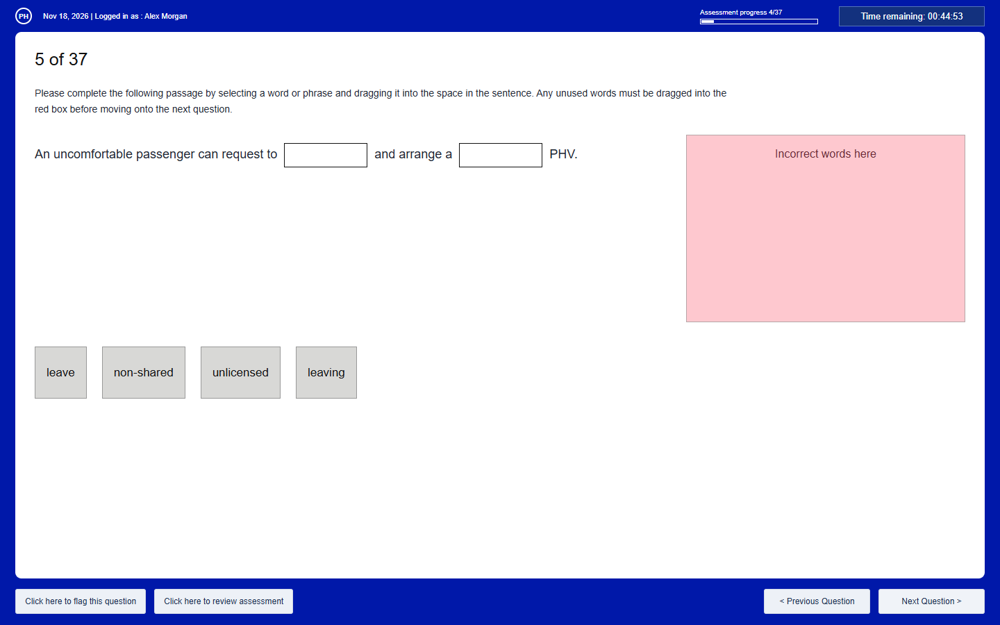
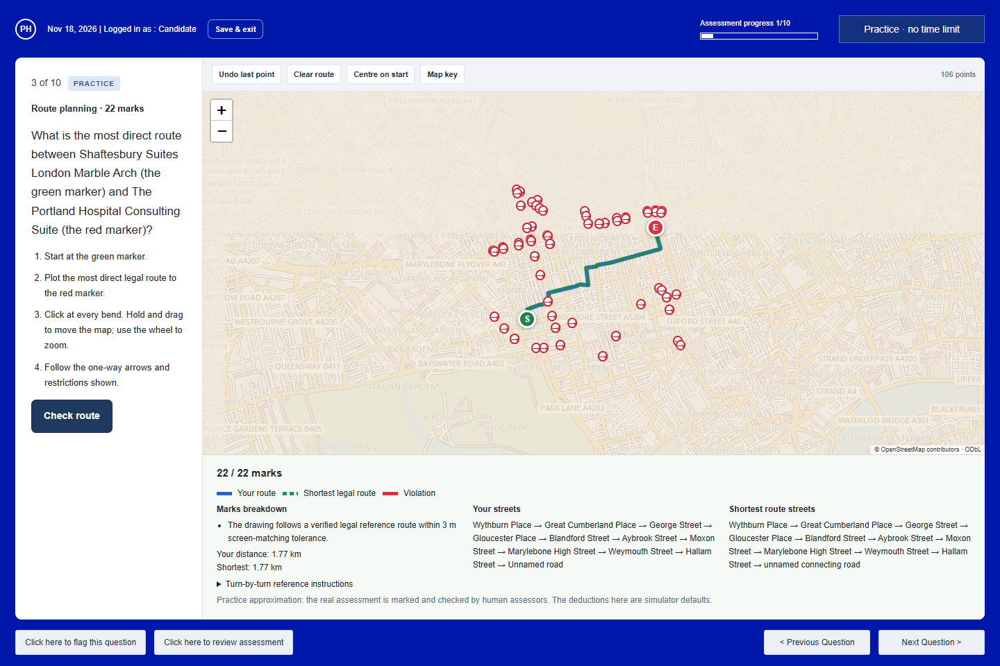

# PHV Exam Trainer

A free, offline practice app for London private hire applicants preparing for **SERU** and the **Topographical assessment**. It does not include the English speaking/listening assessment.

**Unofficial. Not affiliated with or endorsed by Transport for London. Practice questions are original and are not real exam questions. Always study the official PHV Driver's Handbook.**



## Run on Windows

1. Download the repository ZIP and **extract it completely**.
2. Double-click **Start PHV Trainer.bat**.
3. Microsoft Edge opens the local app in a separate app window. If Edge is unavailable, the launcher uses your default browser.

No installation, administrator permission, server, login or internet connection is required. You can also open `app/index.html` directly. Keep the whole extracted folder together: the maps and question files are local assets. Mac/Linux users can run `sh start.sh`, or open `app/index.html`.

Progress stays in the browser's local storage. Use **Settings → Export progress** before moving the folder or switching browsers. Private browsing and browser cleanup can remove stored progress. Official study links open only when clicked and require internet access.

## What is included

- **540 SERU items:** 350 multiple choice, 150 sentence completion and 40 reading questions across all ten handbook sections, with explanations and exact page links.
- **540 Topographical items:** 400 computed map questions plus 60 short routes, 40 closure routes and 40 long routes.
- A local London street atlas with 4,733 WebP tiles at zooms 12–17, static question maps and a map reference page.
- Instruction pages, timed mocks, flagging, question review, finish confirmation, automatic submission and saved attempts.
- Both SERU presets, drag-and-drop with the red discard box, dropdown blanks, and configurable partial credit.
- Straight-line route plotting, an assisted road-following option, undo/clear controls and route comparisons after marking.
- Section/topic drills, mistakes revision, statistics, and local progress export/import.





## Formats and evidence

| Assessment | Simulator composition | Time | Pass |
|---|---|---|---|
| SERU A — provisional default | 18 MCQ + 17 cloze + 2 reading | 45 minutes | 60% |
| SERU B — unverified alternative | 22 MCQ + 12 cloze + 2 reading | 60 minutes | 60% |
| Topographical | 3 routes + 21 other questions; 66 + 34 marks | 70 minutes | 60% |

TfL's [official Topographical video](https://www.youtube.com/watch?v=fp_7mp36cZM) confirms 24 questions and 70 minutes. Its [guidelines](https://content.tfl.gov.uk/topographical-assessment-guidelines.pdf) confirm the three route types, 100 marks, 66/34 split and 60% pass mark. Equal 22-mark routes, the single/two-answer distribution and section order are simulator defaults.

The [official PHV SERU page](https://tfl.gov.uk/info-for/taxis-and-private-hire/licensing/seru-for-private-hire-drivers) confirms handbook-based multiple choice and sentence completion. The [official guide](https://rise.articulate.com/share/U5y7xe0MWMDTLkF6pInkAu0pk4yMGoF0#/) shows radio, reading and drag-and-drop controls. It does **not** settle the current PHV question count/time in the inspected public material. Third-party counts conflict, and some 36-question/60-minute claims describe taxi drivers. Both presets are therefore labelled honestly. The 36+ knowledge checks in the study guide are not an exam question count.

See [RESEARCH.md](docs/RESEARCH.md) for the 53-source register, [UI_SPEC.md](docs/UI_SPEC.md) for observed screens and [UI_DIFF.md](docs/UI_DIFF.md) for the visual comparison. [DECISIONS.md](docs/DECISIONS.md) records every significant default and build deviation.

## Question bank coverage

| Handbook section | MCQ | Cloze | Reading |
|---|---:|---:|---:|
| 1 · Driver licensing | 49 | 21 | 6 |
| 2 · Vehicle licensing | 16 | 7 | 2 |
| 3 · Private hire journeys | 32 | 14 | 4 |
| 4 · Staying safe | 37 | 16 | 5 |
| 5 · Driver behaviour | 20 | 9 | 3 |
| 6 · Driving and parking | 40 | 17 | 4 |
| 7 · Safer driving | 69 | 30 | 7 |
| 8 · Equality and disability | 45 | 19 | 5 |
| 9 · Safeguarding | 29 | 12 | 3 |
| 10 · Ridesharing | 13 | 5 | 1 |
| **Total** | **350** | **150** | **40** |

Topographical questions cover route-planning essentials (70), map symbols (60), places of interest (70), specific streets (70), road numbers (60), compass/direction (70), plus the 140 route exercises. All map answer keys are derived from the released exercise data. Two-answer questions require both choices.

SERU material tests **handbook v1.0**, the edition still linked by TfL when researched on 18 November 2026. Source evidence is an original paraphrase, not a redistributed handbook quotation. Cloze and reading items revisit some MCQ source facts in different formats. The 54-item source audit is documented in [SERU_AUDIT.md](docs/SERU_AUDIT.md); it is an agent source review, not human or TfL certification.

## Map and marking limits

Maps use © OpenStreetMap contributors data under ODbL. They cover a central-London rectangle, **not all Zones 1–2 or Greater London**. Place markers define the exercise endpoint and are snapped within 100 m of an OSM place; entrances/frontages have not been individually verified.

The snapshot represents 1,219 node-via turn restrictions; 172 conditional/via-way restrictions are not represented. Only visible, represented restrictions affect marks. This is an exercise atlas, **not a live navigation product**. Always follow current signs and rules when driving.

Real route answers are marked by human assessors. The automatic deductions and 3 m reference-matching/25 m road corridor tolerances are configurable practice approximations. Read [MARKING.md](docs/MARKING.md) and [MAP_BUILD.md](docs/MAP_BUILD.md). Exact current review/results UI and some detailed SERU rules are not public; the app does not claim to reproduce unpublished software or marking rubrics.

## Rebuild and test — developers only

End users do not need these tools. Development requires Python 3.12+, Node.js and an installed Edge browser. On Windows:

```powershell
python -m venv tools/.venv
tools/.venv/Scripts/python.exe -m pip install -r tools/requirements.txt
npm.cmd --prefix tools ci

# Download the handbook and Geofabrik PBF into ignored research/ as described below.
tools/.venv/Scripts/python.exe tools/build_seru.py
tools/.venv/Scripts/python.exe tools/build_maps.py --extract --tiles --bank

tools/.venv/Scripts/python.exe tools/validate_seru.py
tools/.venv/Scripts/python.exe tools/validate_topo.py
tools/.venv/Scripts/python.exe tools/validate_release.py
node tools/tests/marking.cjs --bank
npm.cmd --prefix tools test
node tools/tests/route-ui.cjs
```

The smaller atlas builder uses pyosmium, Shapely and Pillow instead of the originally proposed Planetiler/MapLibre stack after local disk exhaustion. It renders its own buffered metatiles; it never downloads public OSM raster tiles. See [MAP_BUILD.md](docs/MAP_BUILD.md) for the source URL, source hash, coverage and exact rebuild procedure. Noto fonts and Leaflet are vendored. The handbook remains linked rather than bundled; page extraction instructions are in [SERU_AUDIT.md](docs/SERU_AUDIT.md).

`npm test` opens `file://` in offline Edge and exercises both complete SERU presets, a complete Topographical mock, persistence, flag/review, the timer and progress transfer. The dedicated route suite plots real mouse paths and tests illegal movements. Reports and screenshots are stored in `docs/`. [PROGRESS.md](docs/PROGRESS.md) distinguishes completed checks from verification limits.

## Report a wrong answer

Open an issue with the **question ID**, question wording, selected answer, expected answer, handbook edition/page or map feature, and a short explanation. IDs appear in the progress export and data files. For routing, include the route ID and a screenshot of the plotted path. Do not post candidate personal information or leaked exam content. Original authoring records live under `tools/seru_items_*.txt` and map generators under `tools/build_maps.py`.

Code is MIT. Maps/databases, fonts and vendored libraries retain their own licences: see [ATTRIBUTION.md](ATTRIBUTION.md).

## Publish your repository

No remote is configured and nothing is pushed automatically. After creating an empty public repository named `phv-exam-trainer` on your GitHub account:

```powershell
git remote add origin https://github.com/YOUR_GITHUB_USERNAME/phv-exam-trainer.git
git push -u origin main
git push origin v1.0.0
```

If GitHub CLI is installed and signed in, you can create and push it with:

```powershell
gh repo create phv-exam-trainer --public --source . --remote origin --push
git push origin v1.0.0
```
